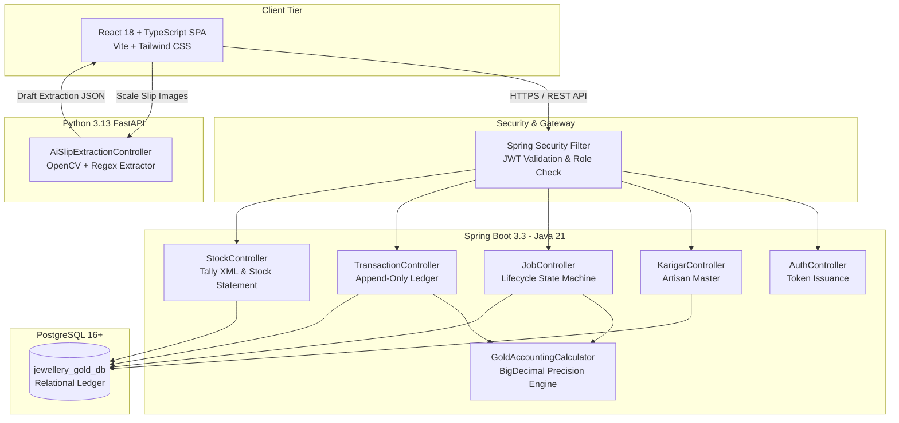

# Jewellery Gold Accountability System
### Enterprise Fine-Gold Tracking, Reconciliation, & Anomaly Detection Platform

[](https://spring.io/projects/spring-boot)
[](https://react.dev/)
[](https://www.typescriptlang.org/)
[](https://fastapi.tiangolo.com/)
[](https://www.postgresql.org/)
[]()

---

## 1. Executive Summary & Problem Context

In the fine jewellery manufacturing cluster of **Coimbatore, Tamil Nadu**, a leading jewellery enterprise operates **5 retail showrooms**, **1 central manufacturing workshop**, and coordinates with **~40 skilled artisan karigars**.

Historically, the enterprise tracked gold issues, jewellery receipts, melting losses, filings, and scrap through handwritten slip books and fragmented Excel workbooks. This manual paradigm introduced severe vulnerabilities:
- **Uncontrolled Fine Gold Leaks**: Discrepancies between gross weight and fine gold content went undetected due to inconsistent purity conversions.
- **Delayed Loss Discovery**: Karigar losses were calculated weeks after job completion rather than during reconciliation.
- **Lack of Anomaly Detection**: No mechanism existed to differentiate between acceptable contractual wastage (e.g., $3.0\%$) and chronic karigar drift or gold diversion.
- **Audit Deficits**: Paper records prevented instant stock verification across showrooms and workshop vaults.

The **Jewellery Gold Accountability System** solves these operational challenges by delivering an auditable, append-only ledger platform where **every gram of fine gold is tracked to three decimal places ($0.001\text{ g}$)** from issue to finished product.

---

## 2. Key Architectural Tenets

### 1. Authoritative Backend Ledger
The single source of truth is an immutable, append-only transaction ledger (`gold_transactions`). Transactions once committed cannot be updated or deleted:
* `ISSUE`: Raw gold bullion or alloy dispatched to a karigar.
* `RECEIPT_JEWELLERY`: Finished jewellery returned from the karigar.
* `RECEIPT_SCRAP`: Usable gold remnants returned.
* `RECEIPT_FILINGS`: Fine dust and filings recovered during polishing and filing.
* `ADJUSTMENT_REVERSAL`: Explicit compensatory ledger entry for authorized corrections.

### 2. Strict BigDecimal Accounting
Floating-point arithmetic is strictly prohibited throughout the accounting engine to eliminate binary rounding drift.
* **Weight Precision**: 3 decimal places (`0.001 g`) with `RoundingMode.HALF_UP`.
* **Purity Precision**: 2 decimal places (`0.01 %`) with `RoundingMode.HALF_UP`.
* **Fine Gold Formula**:
  $$\text{Fine Gold Weight (g)} = \text{round}\left(\text{Gross Weight} \times \frac{\text{Purity \%}}{100},\ 3\right)$$
* **Allowed Loss Formula**:
  $$\text{Allowed Loss (g)} = \text{round}\left(\text{Issued Fine Gold} \times \frac{\text{Wastage Allowance \%}}{100},\ 3\right)$$
* **Reconciled Loss & Excess Loss**:
  $$\text{Actual Loss (g)} = \text{Issued Fine Gold} - \sum \text{Returned Fine Gold (Jewellery + Scrap + Filings)}$$
  $$\text{Excess Loss (g)} = \max(0.000,\ \text{Actual Loss} - \text{Allowed Loss})$$

### 3. Human-in-the-Loop AI Vision Assistance
A specialized FastAPI microservice extracts weights, purities, karigar IDs, and timestamps from photographs of workshop digital scale slips.
* **Non-Authoritative**: The AI service generates *draft suggestions only*.
* **Confidence Scoring & Gap Detection**: Flags missing fields (e.g., missing purity or blurry tare).
* **Mandatory Verification**: Every extracted record requires explicit human clerk confirmation in the web UI before touching the ledger.

### 4. Dual-Engine Anomaly Detection
1. **Rule-Based Contractual Breach**: Flags any job where $\text{Actual Loss} > \text{Allowed Loss}$.
2. **Statistical Karigar Drift**: Calculates a karigar's rolling 30-day loss average across completed jobs ($\ge 5$). Alerts finance when an artisan consistently trends above their baseline, even on individual jobs that technically fall under the contractual maximum.

---

## 3. Implemented Modules & Capabilities

The platform implements all seven core operational modules:

1. **Executive Dashboard (`/dashboard`)**:
   - Total company gold stock across workshop vaults and active jobs.
   - Total gold issued, received, outstanding, and reconciled.
   - Cumulative wastage and active excess loss alerts.
   - Recent transaction audit trail.
2. **Karigar Master (`/karigars`)**:
   - Artisan registry with unique IDs (`KRG-xxx`), contact information, specialty (Casting, Stone Setting, Chains, Traditional), and active job counts.
   - Real-time creation and status tracking.
3. **Issue Gold (`/issue`)**:
   - Multi-step issuance wizard: selects karigar, specifies job type, gross weight, purity (e.g. 91.60% 22K), and agreed wastage allowance percentage.
   - Real-time calculated fine gold preview.
   - Scale slip OCR upload with instant pre-filling.
4. **Receive Gold (`/receive`)**:
   - Job receipt workflow accepting 3 distinct streams: Finished Jewellery, Scrap Gold, and Dust Filings.
   - AI scale slip extraction with draft verification.
   - Real-time outstanding gold balance calculation for the job.
   - One-click Job Reconciliation triggering immediate loss calculation and excess loss detection.
5. **Karigar Ledger & Balance (`/ledger`)**:
   - Comprehensive running ledger per artisan showing chronological debits and credits.
   - Net physical and fine gold balances.
   - Job breakdown and individual transaction receipts.
6. **Loss Alerts & Anomaly Monitor (`/alerts`)**:
   - Filterable alert feed for excess losses and chronic drift.
   - Direct links to associated job vouchers and karigars.
   - Finance head resolution workflow.
7. **Daily Stock Statement & Tally XML Export (`/statement`)**:
   - 5-Pillar daily reconciliation: Opening Balance + Total Issues = Recovered Gold (Jewellery + Scrap + Filings) + Reconciled Loss + Closing Balance.
   - Native **Tally ERP 9 / Tally Prime XML Stock Journal export** button for one-click corporate accounting integration.
   - CSV export for spreadsheet reporting.

---

## 4. System Architecture



---

## 5. Technology Stack

| Layer | Technology | Details |
| :--- | :--- | :--- |
| **Backend API** | Java 21, Spring Boot 3.3.4 | Spring Security, Spring Data JPA, Hibernate, Maven |
| **Accounting Math** | `java.math.BigDecimal` | 3 decimals for weights, 2 for purities, `RoundingMode.HALF_UP` |
| **Database** | PostgreSQL 16+ / 18 | Relational schema, foreign keys, unique job numbers |
| **AI Extraction** | Python 3.13, FastAPI | Pydantic v2, Pillow, OpenCV, Regex scale parser |
| **Frontend SPA** | React 18, TypeScript 5, Vite 5 | Tailwind CSS, Lucide React, Axios, React Router 6 |
| **ERP Integration** | Tally ERP 9 / Tally Prime | Standard XML `<ENVELOPE>` `<VOUCHER>` Stock Journal format |
| **Containerization** | Docker, Docker Compose | Multi-container unified deployment |

---

## 6. Evaluation User Accounts & Security Configuration

The system seeds verified accounts for all three business roles out of the box:

| Role | Username | Password Source | Full Name | Access Scope |
| :--- | :--- | :--- | :--- | :--- |
| `ROLE_FINANCE_HEAD` | `finance_head` | Configured in `.env` (`DEMO_FINANCE_PASSWORD`) | Natarajan Sundaram | Full company visibility, dashboards, loss alerts, Tally export |
| `ROLE_ISSUE_CLERK` | `issue_clerk` | Configured in `.env` (`DEMO_CLERK_PASSWORD`) | K. Ramanathan | Karigar registration, gold issuance, receipt logging, reconciliation |
| `ROLE_KARIGAR` | `murugesan` | Configured in `.env` (`DEMO_KARIGAR_PASSWORD`) | Murugesan A. | Senior Karigar: personal jobs, ledger, and balance (isolated) |
| `ROLE_KARIGAR` | `sivakumar` | Configured in `.env` (`DEMO_KARIGAR_PASSWORD`) | Sivakumar V. | Artisan: personal jobs and balance |
| `ROLE_KARIGAR` | `marimuthu` | Configured in `.env` (`DEMO_KARIGAR_PASSWORD`) | Marimuthu K. | Artisan: personal jobs and balance |

---

## 7. Local Development & Setup

### Prerequisites
- JDK 21+
- Maven 3.9+
- Node.js 18+ and npm
- Python 3.10+
- PostgreSQL running locally on port 5432 with database `jewellery_gold_db`

### Step 1: Database Setup
```sql
CREATE DATABASE jewellery_gold_db;
```

### Step 2: Configure Environment Variables
Set the database password:
```bash
# Windows PowerShell:
$env:SPRING_DATASOURCE_PASSWORD="your_postgres_password"

# Linux / macOS:
export SPRING_DATASOURCE_PASSWORD="your_postgres_password"
```

### Step 3: Run the AI Service
```bash
cd ai-service
pip install -r requirements.txt
python -m pytest tests/
uvicorn main:app --host 0.0.0.0 --port 8000 --reload
```

### Step 4: Run the Backend API
```bash
cd backend
mvn clean test
mvn spring-boot:run
```

### Step 5: Run the Frontend
```bash
cd frontend
npm install
npm run build
npm run dev
```
Open `http://localhost:5173` in your browser.

---

## 8. Docker Compose Deployment

Run the complete stack with a single command:
```bash
docker compose up --build
```
- Frontend: `http://localhost:3000`
- Backend API: `http://localhost:8080/api`
- AI Microservice: `http://localhost:8000`
- PostgreSQL: Port `5432`

---

## 9. Automated Test Suites & Verification

### Backend Test Results (Maven Surefire)
```text
[INFO] Running com.coimbatore.jewellery.AuthenticationIntegrationTest
[INFO] Tests run: 5, Failures: 0, Errors: 0, Skipped: 0
[INFO] Running com.coimbatore.jewellery.domain.accounting.GoldAccountingCalculatorTest
[INFO] Tests run: 12, Failures: 0, Errors: 0, Skipped: 0
[INFO] Running com.coimbatore.jewellery.GoldDomainWorkflowTest
[INFO] Tests run: 3, Failures: 0, Errors: 0, Skipped: 0
[INFO] Running com.coimbatore.jewellery.KarigarSecurityIsolationTest
[INFO] Tests run: 4, Failures: 0, Errors: 0, Skipped: 0
[INFO] Running com.coimbatore.jewellery.service.JobLifecycleAndConcurrencyTest
[INFO] Tests run: 3, Failures: 0, Errors: 0, Skipped: 0
[INFO] 
[INFO] Results:
[INFO] Tests run: 27, Failures: 0, Errors: 0, Skipped: 0
[INFO] BUILD SUCCESS
```

### AI Service Test Results (Pytest)
```text
tests/test_api.py ....                                                   [ 50%]
tests/test_extractor.py ....                                             [100%]
============================== 8 passed in 0.41s ==============================
```

### Frontend Build Results (TypeScript & Vite)
```text
✓ 1512 modules transformed.
dist/index.html                   1.02 kB
dist/assets/index-lIByGJ8Z.css   26.50 kB
dist/assets/index-ZH1RQAKx.js   241.35 kB
✓ built in 2.56s
```

---

## 10. Sample Calculation Verification

The core calculation mandated in the assignment specification was verified in unit tests ([`GoldAccountingCalculatorTest.java`](backend/src/test/java/com/coimbatore/jewellery/domain/accounting/GoldAccountingCalculatorTest.java)):

| Stage | Input Figures | Mathematical Computation | Result |
| :--- | :--- | :--- | :--- |
| **Issue** | Gross: $120.000\text{ g}$, Purity: $91.60\%$, Wastage Allowance: $3.00\%$ | $120.000 \times 0.9160 = 109.920\text{ g fine gold}$<br>Allowed Loss: $109.920 \times 0.03 = 3.2976 \approx 3.298\text{ g}$ | **Fine Gold: $109.920\text{ g}$**<br>**Allowed Loss: $3.298\text{ g}$** |
| **Receipt 1 (Jewellery)** | Gross: $112.450\text{ g}$, Purity: $91.60\%$ | $112.450 \times 0.9160 = 103.0042 \approx 103.004\text{ g}$ | **Fine Gold: $103.004\text{ g}$** |
| **Receipt 2 (Scrap)** | Gross: $3.300\text{ g}$, Purity: $91.60\%$ | $3.300 \times 0.9160 = 3.0228 \approx 3.023\text{ g}$ | **Fine Gold: $3.023\text{ g}$** |
| **Total Recovered** | Jewellery ($103.004\text{ g}$) + Scrap ($3.023\text{ g}$) | $103.004 + 3.023 = 106.027\text{ g}$ | **Recovered Fine: $106.027\text{ g}$** |
| **Pre-Reconciliation Balance** | Issued ($109.920\text{ g}$) - Recovered ($106.027\text{ g}$) | $109.920 - 106.027 = 3.893\text{ g}$ | **Outstanding Fine: $3.893\text{ g}$** |
| **Reconciled Loss & Breach** | Actual Loss: $3.893\text{ g}$, Allowed: $3.298\text{ g}$ | $3.893 - 3.298 = 0.595\text{ g excess}$ | **Actual Loss: $3.893\text{ g}$**<br>**Excess Loss: $0.595\text{ g}$** *(ALERT TRIGGERED)* |

---

## 11. Git Repository & Submission Details

* **GitHub Repository**: [https://github.com/Ayush5424/jewellery-gold-accountability](https://github.com/Ayush5424/jewellery-gold-accountability)
* **Branch**: `main`
* **Submission Artifact**: `jewellery-gold-accountability-submission.zip` ($\le 25\text{ MB}$, containing exclusively `TDD.pdf` and `deployment.md`).
