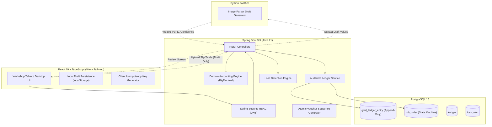

# Coimbatore Jewellery Chain — System Architecture

## System Boundaries

## Security & Access Control Matrix
| Role | Issue Gold | Receive Gold | Finalize Reconciliation | View Own Ledger | View All Showroom Stock | Export Stock Reports |
|---|:---:|:---:|:---:|:---:|:---:|:---:|
| `ISSUE_CLERK` | Yes | Yes | Request Only (`READY_FOR_RECONCILIATION`) | Assigned Jobs | No | No |
| `FINANCE_HEAD` | Yes | Yes | Yes (`RECONCILED`) | All | Yes | Yes |
| `KARIGAR` | No | No | No | Own Slips Only | No | No |
